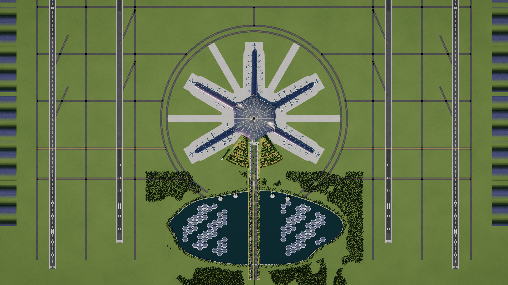
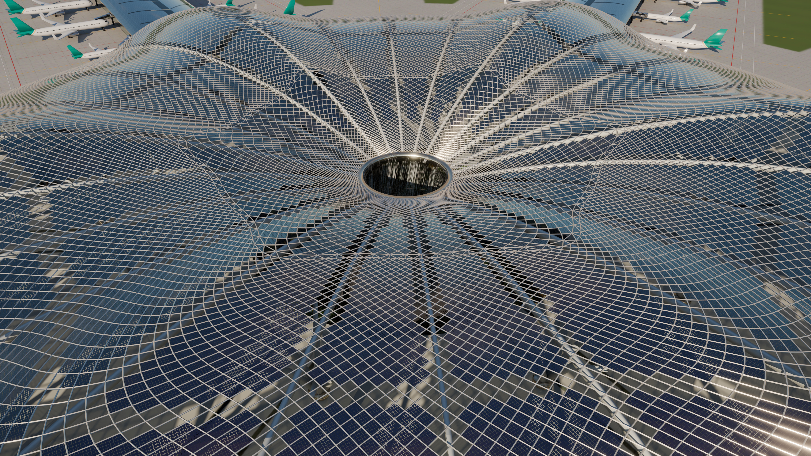
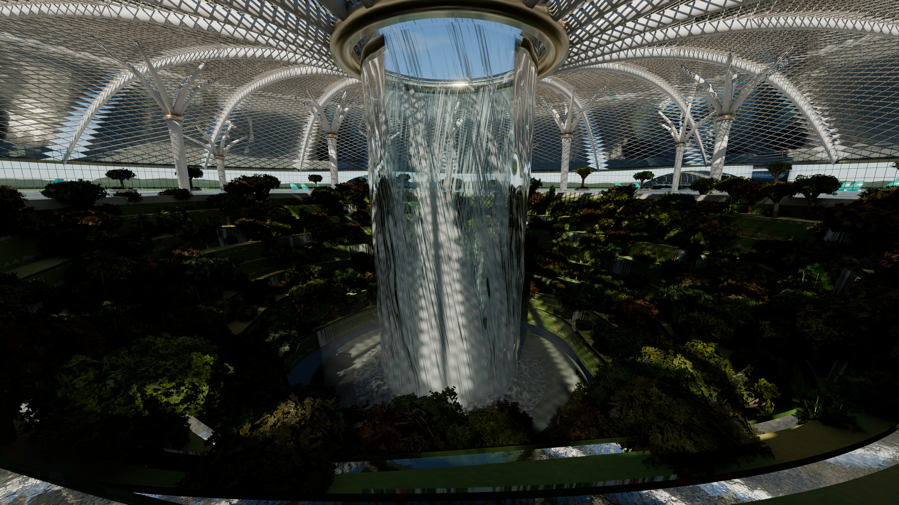
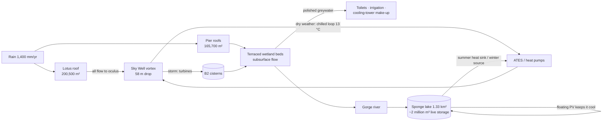

# Qingyun Shanshui International Airport · 青云山水国际机场
### Design and engineering concept

> **One idea runs through the whole airport: water and light follow the same path as the passengers.**
> Rain lands on a solar roof shaped like an upturned lotus leaf. It runs to the centre and falls 58 m through the
> terminal as a chilled waterfall. On the way it cools the hall, then lands in the station where the trains arrive,
> and leaves through a gorge to a lake that powers the airport. Passengers move the same way: arrivals follow the
> water down to the trains, and departures follow the light up to the gates.

This document describes a **concept design**. It is not a construction design. Wherever the text gives a number,
it shows where the number came from. Numbers labelled *model* are measured from the 3D model with
`blender/stats.py`. Numbers labelled *est.* are order-of-magnitude engineering estimates, and the working is shown
next to them. The [last section](#what-is-speculative-and-what-would-break-first) lists what is speculative.

---

## 1 · Concept: *shan shui* (mountain–water) as infrastructure

Large Chinese airports set the world standard for scale and speed. Daxing, for example, has a radial starfish
plan and puts high-speed rail under the terminal. Qingyun keeps that logic, which is driven by walking distances,
and changes what the building *does* with its site:

| Element | Painting metaphor | Actual job |
|---|---|---|
| **Lotus hub** (inverted gridshell) | the lotus | 200,500 m² solar roof *(model)* that collects rain. Its shape funnels all rain to a single drain. |
| **Sky Well vortex** | the waterfall | Roof drain, cooling device, wayfinding landmark and station skylight in one element. |
| **Terraced hills** | the mountains (山) | Green roofs over the ground transport centre and car parks. Rice-terrace wetland beds clean greywater. |
| **Gorge** | the valley | Road access. The river through it carries stormwater from the hub to the lake. |
| **Sponge lake** | the water (水) | About 2 million m³ of stormwater storage *(est.)*, a cooling heat sink and a floating-PV field. |
| **Lily-pad vertiports** | lotus pads | Landside eVTOL pads on lotus-stalk columns. The notch in each pad is the access-bridge slot. |
| **Bud tower** | lotus bud | Air traffic control tower: a twisted shaft and a glazed cab with an outward lean. |
| **Ink-wash ridges** | distant peaks | Landscape context (the hills of the Yangtze delta). |

**Site assumption:** a delta plain in the Yangtze River Delta, with about 1,400 mm/yr of rain, hot humid summers,
typhoon exposure and moderate seismicity. The landside faces south, following the traditional Chinese
orientation, so the terminal's front door looks across the lake.

---

## 2 · Master plan

| Item | Value | Notes |
|---|---|---|
| Runways | 4 × 3,800 m × 60 m (+7.5 m shoulders) | *model* |
| Spacing within each pair | **780 m** | ICAO Annex 14 allows **segregated** parallel operations (one runway for arrivals, one for departures) at ≥ 760 m. Dependent approaches need 915 m and independent approaches 1,035 m. |
| Spacing between the two pairs | 3,120 m | The pairs operate fully independently. |
| Threshold stagger | 300 m | Inner and outer runways |
| Contact stands | **75** (5 piers × 15) | *model*. Roughly 70–80 Mppa at about 1 Mppa per contact stand, a common first-cut planning ratio *(est.)*. |
| Farthest gate from hub centre | 807 m | *model*. About 700 m from central security, or 8 minutes walking at 1.4 m/s. With moving walkways it falls to about 6 minutes, comparable to Daxing's published "under 8 minutes". |
| Taxiways | Horseshoe double ring at R = 1,015 / 1,080 m, three parallel taxiways per side, rapid exits | The ring stays open on the landside, so roads never cross an active taxiway. |

**Why five piers plus one landside lobe?** A radial plan minimises the worst-case walk for a given number of
stands. The sixth lobe (south) carries no aircraft: it is the landside "mountain". All road, rail and pedestrian
access arrives from that single direction and never crosses the airfield.

---

## 3 · The Lotus hub: an inverted gridshell that drains the sky

### 3.1 Geometry

* **Plan:** a hexafoil with radius 232 m in the notches and 282 m at the lobe tips (464–564 m across), with 16 m
  eave overhangs.
* **Section:** an *inverted lotus leaf*. The oculus rim (z = 36 m) is the **lowest** point of the roof. The roof
  rises to a crest of 53–58 m at half radius, then curls down to the eave like a leaf margin. Lotus leaves funnel
  water to their centre in the same way.
* **Lattice:** a **log-polar (loxodromic) diamond gridshell**. The grid is square in (ln r, θ) and rotated by
  45°. That conformal map produces two families of logarithmic spirals that cross at right angles. As a result,
  **every panel is a near-square diamond whose size grows in proportion to its radius**: about 1 m beside the
  oculus and about 9 m at the eaves. Panels stay close to planar, member lengths vary smoothly, and the pattern
  draws the eye towards the vortex. Two zones (96 and then 192 spirals) are joined by a triangulated transition
  ring, so the outer panels do not become too large.
  *model:* 19,296 nodes, 38,880 members, 19,584 panels.
* **Primary structure:** 24 radial box ribs ("leaf veins") hang beneath the shell. They run between an oculus
  **compression ring** (3.2 × 2.6 m section) and the perimeter edge beam. The shell rests on 24 **banyan
  tree-columns** in two rings (r = 104 m and r = 184 m), each branching into six arms. This shortens the spans to
  about 80–100 m, which is within the range of long-span steel gridshells.
* **Isolation:** the maglev and metro run directly beneath the Sky Well. As at Daxing, the hub therefore sits on a
  **seismic and vibration isolation layer**. Daxing's terminal uses about 1,124 rubber isolation bearings plus
  sliding bearings and viscous dampers [5].

### 3.2 Skin: a roof that is also a power plant

* **74 % semi-transparent BIPV laminated glass** (147,400 m² *model*). About 84 % of each panel is covered by
  cells, and the gaps let dappled light through: the "leaf canopy" effect visible in the interior render.
* **26 % clear low-iron glass "veins"** (53,100 m² *model*). These are 24 radial bands, a halo at the crest, and
  a fully glazed funnel around the oculus. Their job is to put daylight where people are and where the gardens
  need it.
* Self-cleaning (photocatalytic TiO₂) outer glass. This is the *lotus effect*, and rain does the cleaning.

### 3.3 Why the inverted shape matters

A conventional dome sheds water outwards, which needs gutters and siphonic downpipes, and puts drain lines above
the hall. An inverted shell has one drain: the oculus. The roof's hydraulics, its structure (the compression
ring) and its architecture (the waterfall) are the same object.

---

## 4 · The Sky Well vortex: a waterfall with four jobs

The vortex is a cylindrical curtain of water about 27 m across. It falls **58 m** from the oculus rim (+36 m) to
the pool at the B2 rail level (−22 m). For comparison, Jewel Changi's Rain Vortex falls about 40 m and runs at
about 10,000 US gal/min (0.63 m³/s) [1].

**Job 1: roof drain (storm mode).** In a 60 mm/h design storm, the 200,500 m² roof delivers
`200,500 × 0.06 / 3600 ≈ 3.3 m³/s` to the oculus. Spread along the 100 m weir perimeter, that is
q ≈ 0.033 m³/s per metre, so the head over the weir is only `h ≈ (q/1.84)^(2/3) ≈ 7 cm`. The oculus can
carry a storm without any visible strain. **The bigger the storm, the bigger the show.** In-line turbines in the
B2 drop structure can recover up to `ρgQHη ≈ 1000·9.81·3.3·58·0.85 ≈ 1.6 MW` at peak, but only about 30 MWh/yr
in total *(est.)*. That figure is honest but symbolic: the point is that the drain *is* the spectacle.

**Job 2: an air-washer the size of a building (dry-weather mode).** Waterfalls inside humid buildings normally
*add* moisture; Jewel throttles its flow partly for this reason [1]. Qingyun runs the vortex loop at **13 °C**,
which is below the dew point of the hall air (about 15 °C at 25 °C and 55 % RH). Water below the dew point
condenses moisture out of the air instead of evaporating into it. This is the principle of the spray-type air
washer used in HVAC dehumidifiers [6]. The calculation:

* Wetted area: 2 curtain layers × 2 faces × (2π · 13.5 m · 58 m) ≈ 19,700 m², plus spray.
* Combined sensible and latent transfer at about 15 W/m²·K over about 8 K gives **≈ 2–3 MW of cooling**
  *(est.)*. The cooling arrives exactly where stratification makes conventional air conditioning least effective.
* At a show flow of 0.6 m³/s the water warms by only `Q/(ṁc) ≈ 2.4 MW / (600 kg/s · 4.19 kJ/kg·K) ≈ 1 K`
  per pass, so the loop stays cold.
* The condensate (≈ 1 m³/h of distilled water at peak) is harvested.
* The pumping energy (0.6 m³/s over about 62 m of head, roughly 0.45 MW while running) replaces part of the
  chilled-water distribution. The vortex *is* a chilled-water riser.

**Job 3: wayfinding.** Rills set into the Lotus Hall floor run along every lobe axis towards the Sky Well. The
rule is simple: *follow the water down*. It leads to baggage reclaim, the maglev, the metro and the high-speed
rail, all at the bottom. Departing passengers move away from the water towards the light.

**Job 4: acoustic masking.** The broadband sound of falling water covers announcements and the low-frequency hum
of the building.

The Sky Well itself is a nine-level terraced garden canyon (60 m → 26 m radius). Its walls are vine-covered, small
cascades spill from every lip, and the planting is dense: bamboo, maple, cherry, ginkgo and camphor. It is a
constructed-wetland polishing stage for the greywater loop and the visual heart of the terminal.

---

## 5 · Water: the sponge airport

* **Capture:** 366,200 m² of terminal roofs *(model)* × 1.4 m/yr × 0.9 runoff ≈ **460,000 m³/yr** *(est.)*.
* **Storage:** a lake of 1.33 km² *(model)* with a 1.5 m operating band holds about **2.0 million m³**. Daxing's
  wetlands, lakes and streams provide about 2.8 million m³ of natural storage [3].
* **Treatment:** the landside terraces (green-roof footprint ≈ 0.17 km² *model*) are **subsurface-flow
  constructed wetlands**. Water moves through the gravel beds, not over them, which matters for wildlife (§9).
* **Conveyance:** the gorge river is the open channel between the hub and the lake. It also shows the system to
  every arriving car.

---

## 6 · Energy

| Source | Area | Capacity | Annual yield *(est.)* |
|---|---|---|---|
| Hub BIPV (84 % cell cover, ~20 % efficiency) | 147,400 m² *model* | ≈ 25 MWp | ≈ 23 GWh (curved roof derate 0.85) |
| Pier roofs (PV between the skylight veins) | 165,700 m² *model* | ≈ 29 MWp | ≈ 29 GWh |
| Floating PV, 85 hexagonal islands on the lake | 136,900 m² *model* | ≈ 30 MWp | ≈ 35 GWh (water cooling bonus) |
| Ground arrays outside the runway strips (22° tilt, south-facing) | 1.90 km² panel area *model* | ≈ 420 MWp | ≈ 460 GWh |
| **Total** | | **≈ 500 MWp** | **≈ 550 GWh/yr** |

Assumptions: specific yield about 1,100 kWh/kWp for the Yangtze delta and about 220 W/m² module rating. Today's
crystalline modules make that rating conservative. Perovskite–silicon tandems have reached **35.5 %** cell and
**31.4 %** module efficiency in the lab (LONGi, 2026) [7], but they are not yet in mass production, so this design
does **not** rely on them. The roof and panel frames are dimensioned so tandem modules can be swapped in later.

**Demand** *(est.)*: about 870,000 m² of terminal floor area × about 200 kWh/m²·yr ≈ 175 GWh. Add pre-conditioned
air and 400 Hz power at every stand (so aircraft APUs stay off), electric ground equipment and taxi tugs, rail,
lighting and EV charging, and the total is **≈ 300 GWh/yr**. Studies of a large Beijing terminal find electricity
intensity roughly double that of typical large public buildings [8], which is the basis for the 200 kWh/m² figure.

**Result:** on paper the airport is a net annual exporter of electricity (≈ 1.8×). Without the ground arrays, the
building-integrated sources still cover about 30 %. Seasonal and daily mismatch is handled by:

* **Aquifer thermal energy storage (ATES):** store winter cold for summer cooling and summer heat for winter.
  Stockholm Arlanda runs the world's largest aquifer store for exactly this purpose [4].
* **Ground-source heat pumps** under the aprons. Daxing uses a large composite ground-source system [3].
* **Decoupled cooling:** radiant floors handle the sensible load. A **liquid-desiccant** dedicated outdoor-air
  system handles the latent load, regenerated at 60–80 °C by PV-thermal panels [9]. This is the best-known
  high-efficiency combination for hot humid climates, and the chilled vortex adds a third, spectacular latent sink.
* **Stack ventilation** through the oculus in spring and autumn (the funnel roof forms a natural solar chimney).

**Glare:** PV near runways and control towers needs a glint and glare study before approval (anti-reflective
glass, tilt and orientation). The arrays sit outside the runway strips, south-facing and low.

---

## 7 · Mobility

* **Maglev and high-speed rail at B2**, directly beneath the vortex. The line runs elevated over the lake, which
  makes it the visual axis of the arrival, then dives into a portal at the north shore and runs in tunnel under
  the gorge.
* **Roads** arrive through the gorge, with departures and arrivals curbs on the forecourt. A **water curtain**
  falls from the roof eave over the south facade, and pedestrians enter through openings in it.
* **Lily-pad vertiports:** four landside eVTOL pads on the lake's north shore. China's CAAC issued the first eVTOL
  type certificate (EHang EH216-S, October 2023) and the first air operator certificates (March 2025) [10].
* **Airside:** pre-conditioned air and 400 Hz power at all 75 stands, electric taxi tugs to the hold points (no
  engine taxiing), and the hydrant corridor sized so a future hydrogen line can share it.

---

## 8 · Landscape and planting

The palette is the Yangtze delta in November: evergreen **camphor**, golden **ginkgo** ribbons along the terrace
lips, red **maple**, pink autumn-flowering **cherry**, **weeping willows** at the water, **pine** and **bamboo**
groves. The model instances about 126,000 trees and shrubs, generated procedurally with alpha-tested leaf-cluster
cards. A forest belt surrounds the airfield; inside the fence the airfield is mown grass only.

---

## 9 · Wildlife and safety: the honest part

Water features near runways attract birds. FAA AC 150/5200-33 recommends 10,000 ft (about 3 km) between hazardous
wildlife attractants and airports that serve turbine aircraft. It treats wet stormwater basins as attractants and
recommends detention ponds that drain within 48 hours [2]. The lake centre is about 1.3 km south of the hub, and
its east and west tips come within about **0.5 km** of the inner runway centrelines. That is far inside the 3 km
guidance, so **this is the design's weakest point.**
Mitigations in the design:

1. **Open water inside the building or moving fast:** the vortex, the cascades and the rills.
2. **Subsurface-flow wetlands** on the terraces, so there is no standing surface water.
3. **About 19 % of the lake covered by floating PV islands** (85 × 3,000 m²), set back from the shore. The steep
   margins have no emergent vegetation on the airside, and the open water lies outside the approach funnels, which
   run north–south over the runway ends at x = ±1.56 km and ±2.34 km.
4. **Avian radar** and an active wildlife hazard management programme.
5. **Fallback:** if a wildlife hazard assessment rejects the open lake, it becomes a vegetated dry-detention
   meadow that empties within 48 hours. Storage, conveyance and the floating PV (as ground-mount) all survive the
   change.

**Other safety points:**

* **Typhoon loads:** the hub's low profile, double-curved shell and sealed laminated panels suit typhoon loading.
* **Fire:** the Sky Well is a smoke reservoir by geometry. The open oculus at the top is the smoke vent.

---

## 10 · What is speculative, and what would break first

| Claim | Confidence | Why |
|---|---|---|
| Inverted gridshell with oculus drain | High | Inverted and funnel roofs (Candela umbrellas, Jewel's torus) are proven. The span is ambitious but can be supported with 24 columns. |
| Chilled vortex as dehumidifier | Medium | The physics is textbook (air washer). Scale, splash control and legionella management need CFD and full-scale testing. |
| 2–3 MW of vortex cooling | Low–medium | The transfer coefficient is the key uncertainty. |
| Annual net-positive energy | Medium | Depends on 1.9 km² of ground PV passing glare review. |
| Lake near runways | **Low** | See §9. It is the element most likely to change. |
| 75 contact stands → 70–80 Mppa | Medium | A planning ratio, not a simulation. |

---

## References

1. Jewel Changi Airport, Wikipedia (Rain Vortex: 40 m, flow alternates to limit humidity); Dezeen, *World's tallest indoor waterfall*, 2019. https://en.wikipedia.org/wiki/Jewel_Changi_Airport · https://www.dezeen.com/2019/03/12/moshe-safdie-worlds-tallest-indoor-waterfall-changi-airport/
2. FAA Advisory Circular 150/5200-33C, *Hazardous Wildlife Attractants on or near Airports*. https://www.faa.gov/documentLibrary/media/Advisory_Circular/150-5200-33C.pdf
3. World Economic Forum, *Beijing Daxing: the world's biggest airport*, 2019 (ground-source heating, 2.8 million m³ natural water storage, ≥ 10 MW PV). https://weforum.org/stories/2019/09/worlds-biggest-airport-bejing-zaha-hadid
4. Swedavia, *The aquifer* (Stockholm Arlanda ATES). https://www.swedavia.com/about-swedavia/the-aquifer · IRENA, *Innovation landscape: low-temperature thermal energy storage*. https://www.irena.org/Innovation-landscape-for-smart-electrification/Power-to-heat-and-cooling/6-Low-temperature-thermal-energy-storage
5. *Key technological innovations in the construction of the main terminal of Beijing Daxing International Airport*, Frontiers of Engineering Management, 2022 (1,124 rubber isolation bearings, 108 sliding bearings, 144 dampers). https://journal.hep.com.cn/fem/EN/10.1007/s42524-022-0223-3
6. Air washer / spray dehumidification principle: Wikipedia, *Dehumidifier*; US 5,247,809 *Air washer and method*. https://en.wikipedia.org/wiki/Dehumidifier · https://patents.google.com/patent/US5247809
7. pv magazine, *Longi sets new world record with 35.5 % efficient perovskite-silicon tandem cell*, July 2026. https://www.pv-magazine.com/2026/07/15/longi-sets-new-world-record-with-35-5-efficient-perovskite-silicon-tandem-cell/
8. Yang et al., *Electricity consumption characteristics and prediction model of a large airport terminal in Beijing*, City and Built Environment, 2023.
9. Yin, Zhang & Chen, *A new liquid desiccant system for air-conditioned spaces with high latent and cooling load*, 2008. https://engineering.purdue.edu/~yanchen/paper/2009-6.pdf
10. EHang, *EH216-S eVTOL operators obtain air operator certificates*, March 2025. https://ir.ehang.com/news-releases/news-release-details/ehangs-eh216-s-evtol-operators-obtain-air-operator-certificates
11. ICAO Annex 14 Vol. I, parallel runway separations (760 m segregated; 915 m dependent; 1,035 m independent approaches), as summarised in training material; verify against the current edition.
