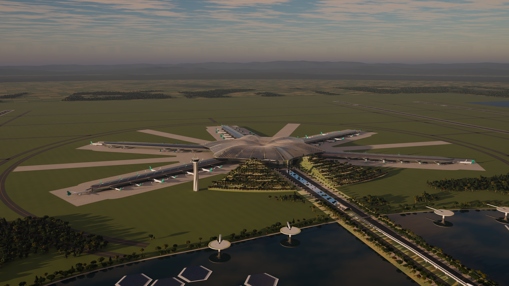
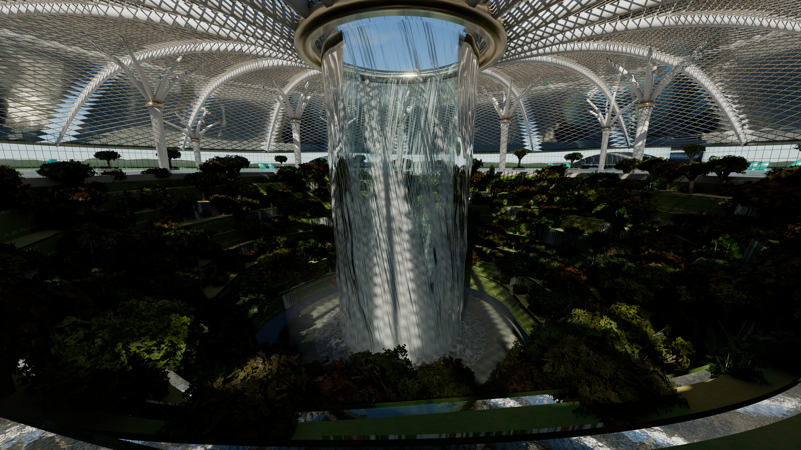
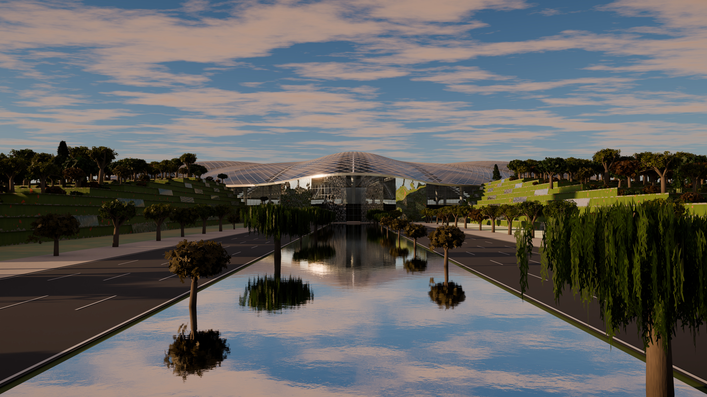
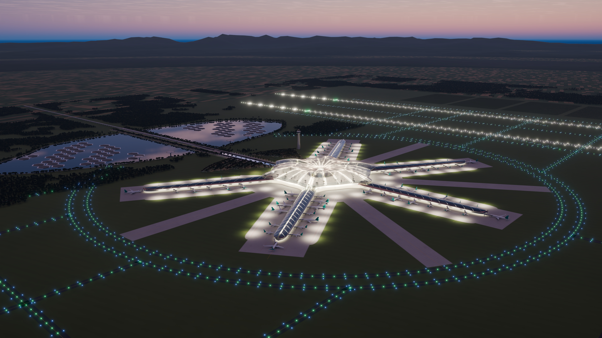
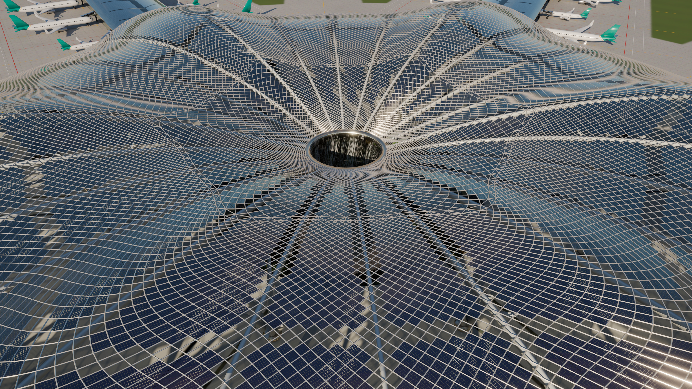
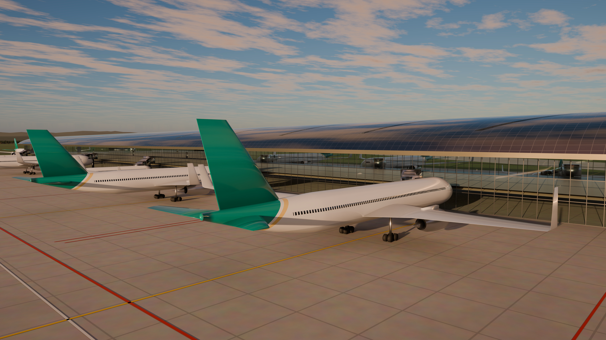
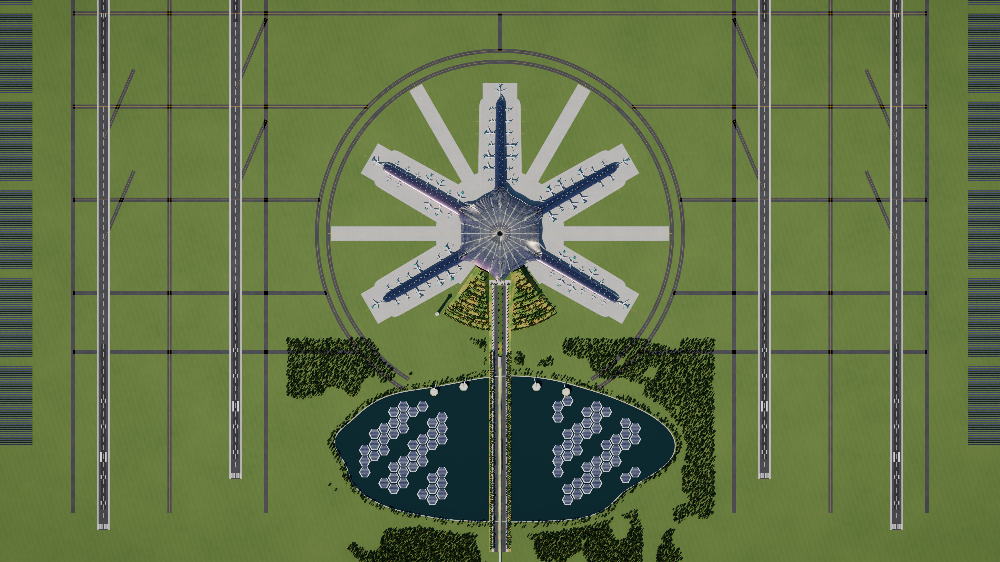

# 青云 Qingyun Shanshui International Airport

**A concept airport where the roof drinks the rain, the waterfall cools the hall, and the landscape is the infrastructure.**



The terminal roof is a 200,000 m² solar gridshell shaped like an **upturned lotus leaf**. All the rain that
falls on it runs to the centre and pours through a 32 m oculus as a **58 m chilled vortex waterfall**, which drops
past nine levels of hanging gardens into the maglev station below. The waterfall is the building's storm drain,
a giant air-washer that cools and dehumidifies the hall, the main wayfinding landmark, and a skylight for the
trains. The landside is a *shan shui* (mountain–water) landscape. Terraced wetland "rice terraces" cover the car
parks, a gorge with a river carries the roads, a water curtain marks the front door, and a sponge lake with
floating solar islands and lily-pad vertiports stores the airport's stormwater.

Full engineering rationale, numbers and references: **[DESIGN.md](DESIGN.md)**

---

## Renders (3840 × 2160, path-traced)

| | |
|---|---|
|  **Sky Well:** the 58 m chilled vortex, terraced gardens, banyan tree-columns and the spiral gridshell |  **Gorge gateway:** the river runs from the water-curtain entrance between terraced hills |
|  **Blue hour:** runway pairs, horseshoe taxiways, glowing hub |  **Oculus:** the log-polar spiral lattice of BIPV and clear "veins" |
|  **Leaf pier:** PV roof with herring-bone skylights, boarding bridges |  **Master plan:** 4 runways, 5 piers, terraced hills, sponge lake |

Full-resolution JPEGs are in [`renders/`](renders/).

## Key figures

| | |
|---|---|
| Hub roof | 200,500 m² — 19,296-node log-polar diamond gridshell, 74 % semi-transparent BIPV / 26 % clear glass |
| Vortex | 32 m oculus, 58 m drop (Jewel Changi's Rain Vortex: 40 m), 13 °C chilled loop ≈ 2–3 MW of cooling (est.) |
| Airfield | 4 × 3,800 m runways: pairs 780 m apart (segregated ops), 3.1 km between pairs (independent) |
| Gates | 75 contact stands on 5 leaf-shaped piers; farthest gate ≈ 700 m from central security |
| Solar | ≈ 500 MWp in total (roofs + 85 floating islands + ground arrays) → ≈ 550 GWh/yr vs ≈ 300 GWh/yr demand (est.) |
| Water | ≈ 460,000 m³/yr captured from the roofs; 1.33 km² sponge lake, ≈ 2 million m³ of live storage |
| Rail | Maglev / high-speed rail at B2 directly beneath the vortex |

## Explore the 3D model

**Interactive (browser):** a three.js viewer with the same camera views, golden-hour / midday / blue-hour
lighting, and animated water.

```bash
python3 -m http.server 8000
```

Then open <http://localhost:8000/web/>. Add `?lite` for low-power GPUs.

**Native:** open `model/qingyun_airport.blend` in **Blender 5.2+**. Every camera in the file (`CAM_*`) is one of
the renders. Switch the render engine to Cycles. The web export is `web/assets/qingyun.glb` (glTF 2.0, meshopt
compressed).

## Rebuild everything from source

The whole scene, including geometry, materials, vegetation, sky and textures, is generated from Python. No
third-party models, textures or HDRIs are used.

```bash
pip install bpy==5.2.3 numpy scipy pillow OpenEXR
```

Build the model:

```bash
python blender/build.py --out model/qingyun_airport.blend
```

Render one shot or `all`:

```bash
python blender/render.py --blend model/qingyun_airport.blend --shots all --res 3840x2160 --samples 64 --jpg
```

Export the web assets:

```bash
python blender/export_web.py --blend model/qingyun_airport.blend --out web/assets
```

Measure the model (the numbers quoted in DESIGN.md):

```bash
python blender/stats.py --blend model/qingyun_airport.blend
```

| Module | Contents |
|---|---|
| `blender/qy/params.py` | Master-plan constants; the hub-roof, lobe and pier plan functions |
| `blender/qy/terminal.py` | Lotus gridshell (log-polar lattice), oculus, Sky Well terraces, vortex, tree-columns, Lotus Hall |
| `blender/qy/piers.py`, `aircraft.py` | Leaf piers, boarding bridges, stand markings; lofted NACA-section airliners |
| `blender/qy/airfield.py` | Runways with ICAO-style markings, taxiways, apron mask, solar fields, lighting, mountains |
| `blender/qy/landscape.py` | Terraced hills, gorge, water curtain, lake + floating PV, vertiports, maglev, control tower |
| `blender/qy/vegetation.py`, `planting.py` | Procedural trees (leaf-card crowns), geometry-nodes instancing, planting plan |
| `blender/qy/materials.py`, `world.py`, `cameras.py` | Procedural PBR materials, physical sky + cloud deck, shots and lighting presets |
| `blender/render.py` | Cycles → EXR → aerial-perspective haze from the mist pass, HDR bloom, vignette → AgX |

*This is a design concept for illustration, not a real or planned project. The three.js library in
`web/vendor/three` is MIT-licensed (see its LICENSE file).*
